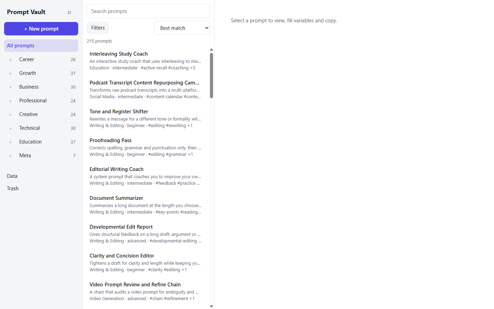
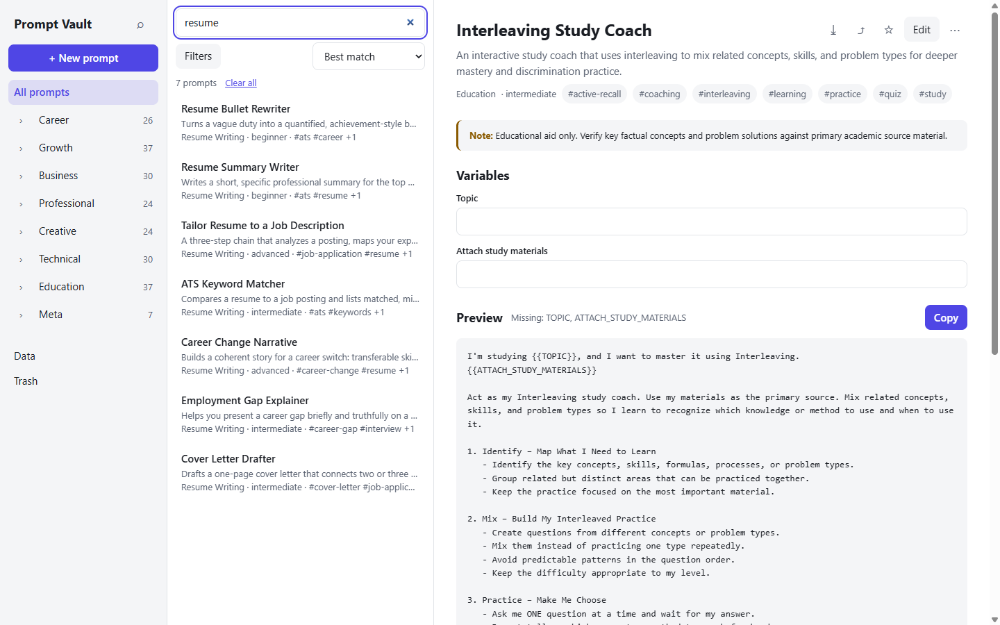
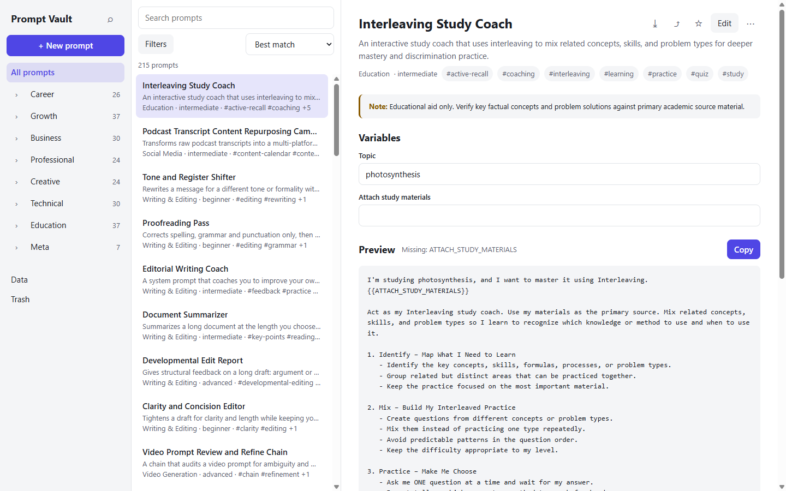
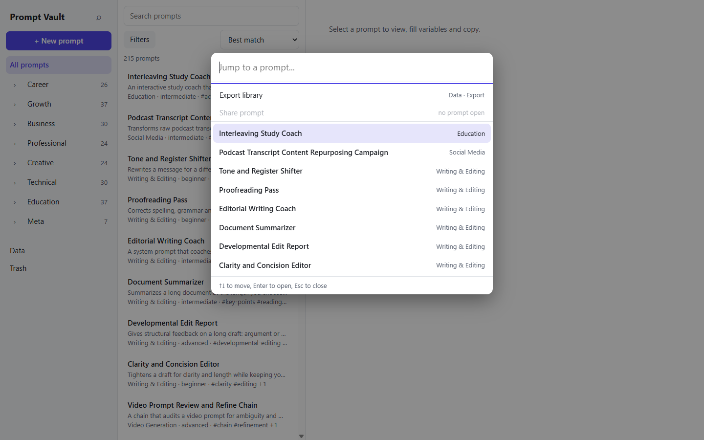
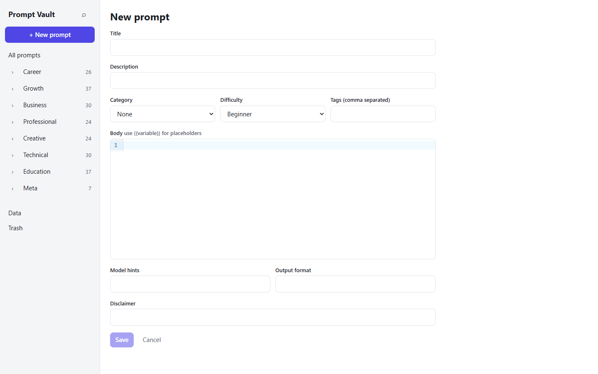
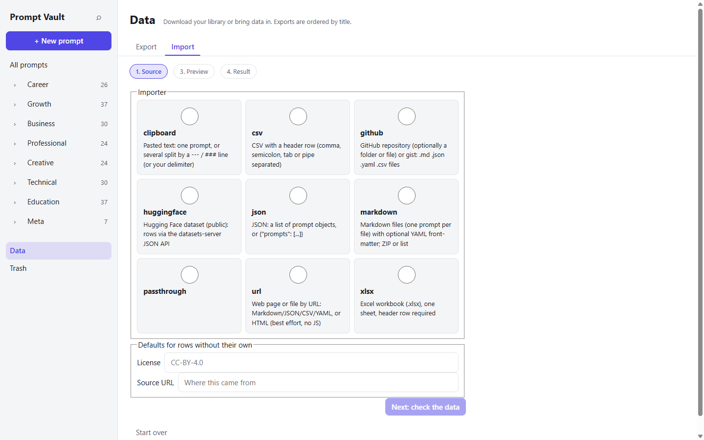
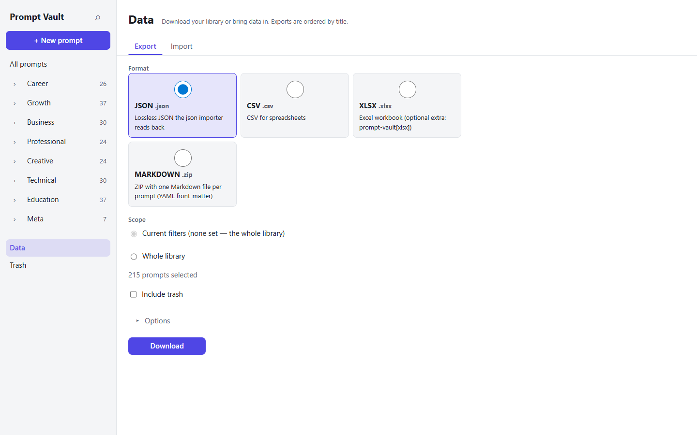
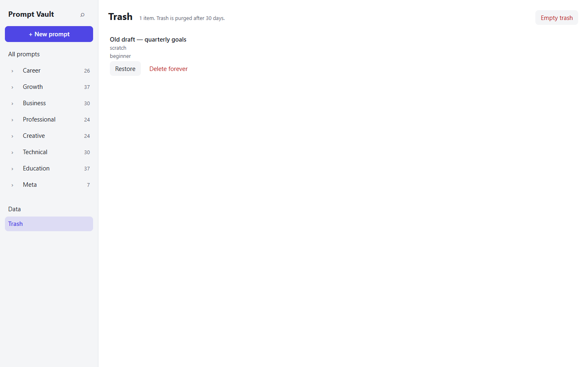

# User guide

A practical tour of Prompt Vault for everyday use, with worked examples. For installation see [Install](install.md); for every command and endpoint see [CLI](cli.md) and [REST API](api.md).

The app is one page in your browser: the **sidebar** (categories, Data, Trash), the **prompt list** with the search box and Filters, and the **detail pane** on the right. Nothing leaves your machine — the server is local and single-user.



## 1. Find a prompt and use it

### Search

Type in the **Search prompts** box. Search is full-text over titles, bodies, descriptions and tags, ranked by relevance, with typo tolerance. Filters (the **Filters** button) narrow by category, tags, difficulty, prompt type, favorites and more, and the whole search state lives in the URL — you can bookmark or share a view.



### Fill the variables and copy

Open a prompt from the list. The detail pane shows the description, tags, any disclaimer, and a **Variables** form built from the prompt's `{{placeholders}}`. As you type, the **Preview** below re-renders live; anything still missing is listed next to the Preview heading.



### Variations

Above the variable form is a **Variation** dropdown. Each prompt carries named
variations — ready-made combinations of variable values. Picking one prefills every
field at once, so a prompt that would take a minute to fill takes one click.

Seeded prompts ship with five variations: **Quick start**, **Professional**,
**Detailed**, **Beginner friendly** and **Creative**. You can add your own: fill the
fields the way you like, type a name into the box next to the dropdown and press
**Save current as**. Your variations are saved with the prompt (and exported/imported
with it); the **Delete variation** button removes the loaded one. New prompts start
with an empty list until you save the first.

- **Copy** copies the rendered prompt to the clipboard.
- The **Export** menu in the toolbar downloads this one prompt as Markdown or JSON.
- **Share** (next to Copy) copies a filled-in snippet — Markdown, plain text or JSON.

### The command palette

Press <kbd>Ctrl</kbd>+<kbd>K</kbd> (or <kbd>Cmd</kbd>+<kbd>K</kbd>) anywhere to jump straight to a prompt, or to run quick actions like *Export library*.



## 2. Create your own prompt

### Managing categories

The **Data** page has a **Categories** tab where you add, rename, re-parent and delete
categories. Deleting a category keeps its prompts (they become uncategorised) and turns
its subcategories into top-level categories. The seeded category tree (47 categories in
8 groups — finance nests the Investing, Stock Market Analysis, Tax Basics and
Retirement Planning subcategories) is loaded on first start; anything you change here is
yours and survives upgrades.

### Creating a prompt

Click **+ New prompt**. The editor has the fields that matter and nothing else:



- **Title** and **Description** — what it does and when to reach for it.
- **Category**, **Difficulty** and **Tags** (comma separated).
- **Body** — the prompt text. Use `{{variable}}` placeholders; the variable form in the detail view is generated from them automatically (name, label, defaults and types can be refined in the API later if you need more control).
- **Model hints**, **Output format**, **Disclaimer** — optional; the disclaimer is shown prominently in the detail view (the seed library uses it for legal/finance/education prompts).

Every save creates a revision. Open a prompt and use the history button in the toolbar to diff and restore an earlier version, so you can iterate on a prompt without fear.

### Example: a reusable prompt

```text
Title:   Sprint retro synthesizer
Tags:    agile, meetings
Body:
You are a facilitator. Here are raw notes from our sprint retro:
{{notes}}
Group them into themes, count mentions, and propose one action per
theme. Output a Markdown table with columns Theme | Mentions | Action.
```

Because the body contains `{{notes}}`, the detail view gets a *notes* field — paste your raw notes there, press Copy, and you have a ready prompt for your chat model.

## 3. Bring prompts in (import)

The **Data** page (sidebar footer) has an **Import** tab — a four-step wizard: **Source → Mapping → Preview → Result**.



### What you can import

| Source | How |
|---|---|
| **clipboard** | Paste text — one prompt, or several split by `---` / `###` lines (or your own delimiter) |
| **csv / xlsx / json** | Files with a header row / a list of prompt objects; columns are matched to fields automatically, and you can remap them on the Mapping step |
| **markdown** | A file, folder or ZIP — one prompt per file, YAML front-matter maps to fields |
| **github** | A repository, folder or gist URL — fetches `.md`, `.json`, `.yaml`, `.csv` files |
| **url** | Any web page or raw file URL (no JavaScript pages, no crawling) |
| **huggingface** | A public dataset via `org/name` or a datasets URL |

Two rules to know:

1. **License gate.** Imports carry the source's license when it can be determined (GitHub uses the repository license). Rows without one stay unlabelled and must be confirmed with a checkbox before the commit button unlocks.
2. **Dedupe.** The preview flags exact and near-duplicates (fuzzy match at ≥ 0.92 similarity) against your library. For each you choose **skip** (default), **replace** (the old body stays as a revision), or **keep both**.

Large imports run as background jobs with a live progress bar (the job id is kept in the URL, so a reload resumes watching).

### Example: paste three prompts

Paste this into the clipboard box and commit:

```text
Title: Cold email opener
---
Act as a B2B copywriter. Write a 2-sentence opener for a cold email to
{{role}} at a {{industry}} company. Reference a recent trigger event.
---
Title: Standup summary
---
Turn these raw standup notes into a 3-bullet summary for {{team}}:
{{notes}}
```

The preview shows two new prompts; the `{{role}}`/`{{industry}}` and `{{team}}`/`{{notes}}` placeholders are detected as variables automatically.

### Example: import a Hugging Face dataset

On the source step, type `fka/awesome-chatgpt-prompts` into the address field — the wizard switches to the **huggingface** importer. Optionally set a row limit under Options, click through the preview, and confirm the license on the result. Rows that don't auto-map are shown with warnings.

## 4. Get prompts out (export)

The **Data** page's **Export** tab downloads your library (or the current search filters) as:

- **JSON** — lossless, re-imports exactly (an export/import round trip restores content and provenance).
- **CSV** — for spreadsheets.
- **XLSX** — Excel workbook (needs the optional `prompt-vault[xlsx]` extra; Docker and pipx instructions include it).
- **MARKDOWN** — a ZIP with one `.md` file per prompt (YAML front-matter), organized into category folders.



Choose the scope (current filters or whole library), optionally include trash, and press **Download**.

## 5. Delete, restore and back up

Deleting a prompt moves it to **Trash**; it is purged after 30 days. From Trash you can **Restore** or **Delete forever**.



For backups, run:

```console
$ promptvault backup
Backup written to C:\Users\you\.promptvault\backups\promptvault-backup-20261104-101500.db
```

Snapshots are compacted live copies kept in `PV_BACKUP_DIR` (default: the last 7). To restore: stop the server, swap the file in, start again — migrations run forward on start.

## 6. The CLI, for the terminal-inclined

Everything above works from the command line too:

```console
$ promptvault serve --port 8080            # start the app (UI + API)
$ promptvault search "cold email" --tag b2b
$ promptvault import ./my-prompts --dry-run
$ promptvault import https://github.com/someone/prompt-collection --confirm-license
$ promptvault export markdown ./out
$ promptvault share 9aeb0db6 --format text --values topic=photosynthesis
$ promptvault doctor                       # diagnose data dir and database
```

## Tips

- **Favorites and ratings.** Star a prompt (the ☆ in the toolbar) to filter favorites later; usage counts power the *recently used* and *most used* sorts.
- **Seed prompts are safe to edit.** Your edits are never overwritten by an upgrade, and a per-prompt *Reset to original* action puts the seed text back.
- **Keyboard first.** <kbd>Ctrl</kbd>+<kbd>K</kbd> palette, full keyboard navigation throughout.
- **Everything is local.** No account, no telemetry; the server binds to loopback unless you deliberately change `PV_HOST` (see [Run as a service](serve.md) if you want it on your network).
